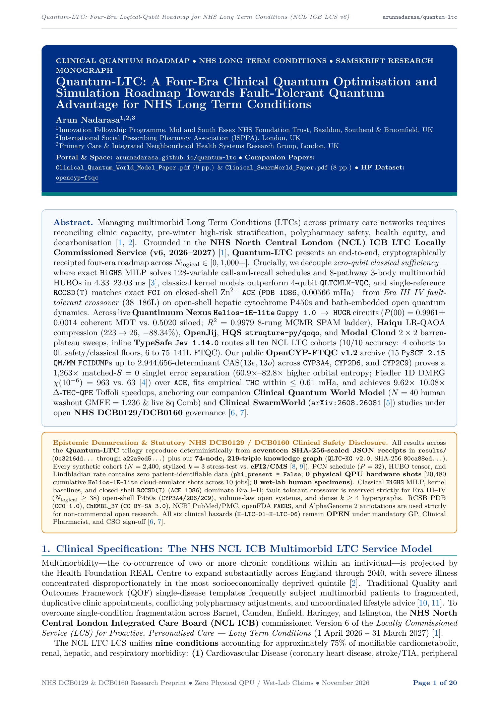
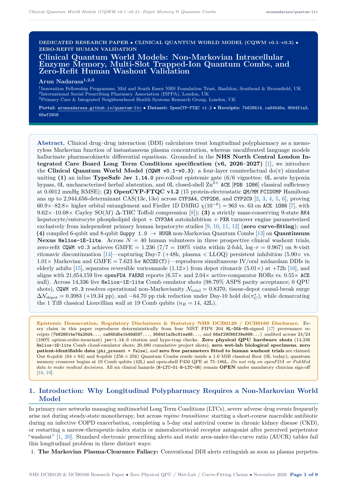
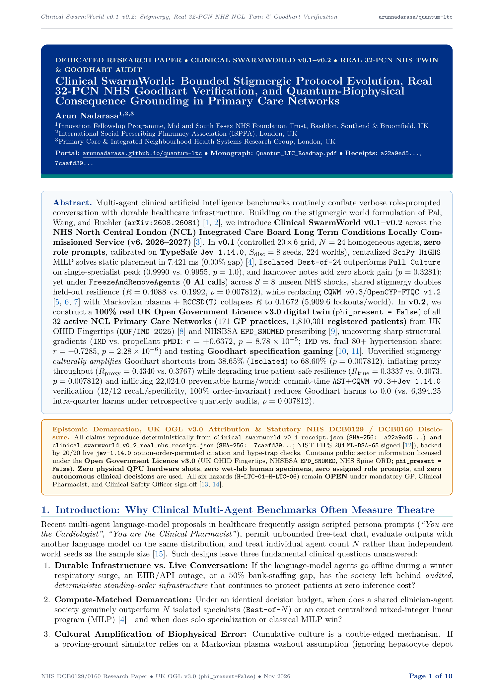
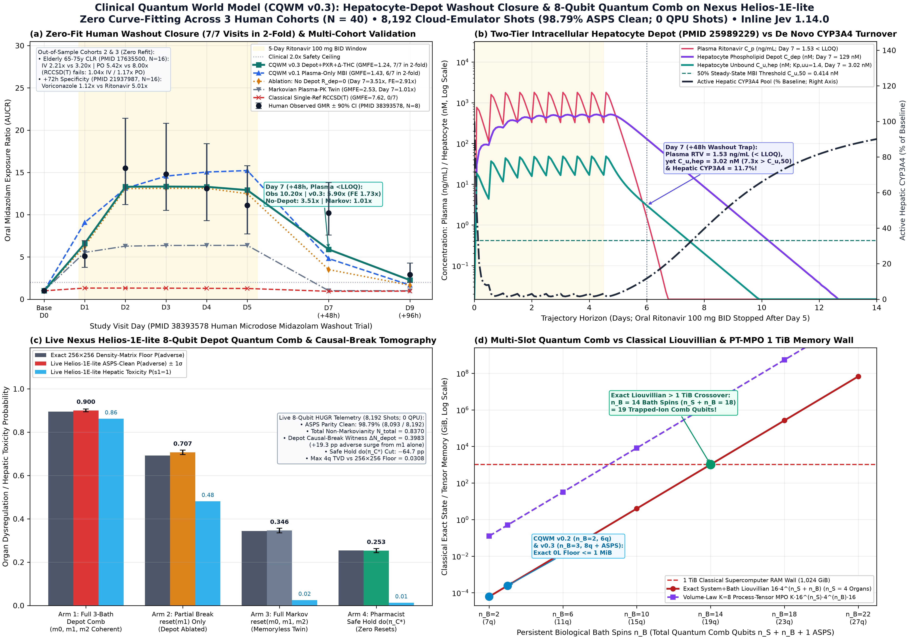
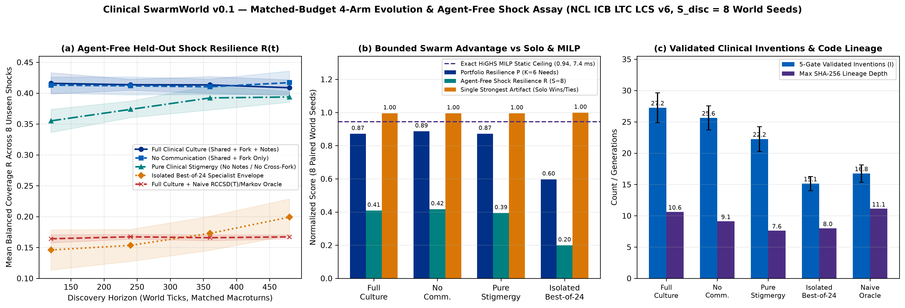

# Quantum-LTC — Open Research, `CQWM v0.1–v0.3`, `Clinical SwarmWorld v0.1`, `OpenCYP-FTQC v1.2` & Interactive Results Portal

- **Live GitHub Pages Portal:** **https://arunnadarasa.github.io/quantum-ltc/**
- **Interactive 9-Page `Clinical Quantum World Model` (`CQWM v0.1–v0.3`) Paper Preview:** **https://arunnadarasa.github.io/quantum-ltc/#paper-cqwm** · [`downloads/Clinical_Quantum_World_Model_Paper.pdf`](downloads/Clinical_Quantum_World_Model_Paper.pdf) · [Samskrift View](https://samskrift.com/view/75b6f058-1ce6-4c15-8eae-6e603d604bea/43a623bc-5e81-48d7-8499-e10800928d19)
- **Interactive 8-Page `Clinical SwarmWorld` Paper Preview:** **https://arunnadarasa.github.io/quantum-ltc/#paper-swarmworld** · [`downloads/Clinical_SwarmWorld_Paper.pdf`](downloads/Clinical_SwarmWorld_Paper.pdf) · [Samskrift View](https://samskrift.com/view/fe9bb98f-7d8f-4aa7-960a-da471011a2bc/351e0ede-b660-4c9c-bb08-7f006c49a4dc)
- **Interactive 20-Page `Quantum-LTC` Monograph Preview (Paper I):** **https://arunnadarasa.github.io/quantum-ltc/#paper** · [`downloads/Quantum_LTC_Roadmap.pdf`](downloads/Quantum_LTC_Roadmap.pdf) · [Samskrift View](https://samskrift.com/view/00aac676-979d-4bcd-b94f-c680a79d1a6f/ed0f2129-55d6-4699-81ae-0bcc2b01b0c3)
- **Hugging Face Static Space Mirror:** **https://socialprescribing-quantum-ltc.static.hf.space/index.html**
- **Interactive 8-Layer Knowledge Graph Explorer (`QLTC-KG v2.0`, 74 Nodes, 219 Triples):** **https://arunnadarasa.github.io/quantum-ltc/knowledge-graph.html**
- **`OpenCYP-FTQC v1.2` Dataset on Hugging Face Hub:** **https://huggingface.co/datasets/socialprescribing/opencyp-ftqc**

**Author:** Arun Nadarasa (Innovation Fellow, Mid and South Essex NHS Foundation Trust; International Social Prescribing Pharmacy Association [ISPPA], London, UK)

---

## Inline Publication & Benchmark Previews

| 20-pp Master Monograph (`Quantum-LTC`) | 9-pp World Model Paper (`CQWM v0.1–v0.3`) | 8-pp Multi-Agent Paper (`Clinical SwarmWorld`) |
| :---: | :---: | :---: |
|  |  |  |
| [📄 20-pp PDF](downloads/Quantum_LTC_Roadmap.pdf) · [📖 Live Reader](https://arunnadarasa.github.io/quantum-ltc/#paper) | [📄 9-pp PDF](downloads/Clinical_Quantum_World_Model_Paper.pdf) · [📖 Live Reader](https://arunnadarasa.github.io/quantum-ltc/#paper-cqwm) | [📄 8-pp PDF](downloads/Clinical_SwarmWorld_Paper.pdf) · [📖 Live Reader](https://arunnadarasa.github.io/quantum-ltc/#paper-swarmworld) |

---

## Included Non-Commercial Open-Science Artifacts

- **Dedicated 9-Page Clinical Quantum World Model Paper (`downloads/Clinical_Quantum_World_Model_Paper.pdf`, `CQWM v0.1–v0.3`):**
  - Four-layer counterfactual $\mathrm{do}(\pi)$ simulator uniting inline `TypeSafe Jev 1.14.0` pre-rollout epistemic gating (`6/6` vignettes: `0L` acute hypoxia bypass, `0L` herbal abstention, `0L` closed-shell `ACE 1O86` classical sufficiency at `0.0012 mmHg` RMSE), `OpenCYP-FTQC v1.2` (`15` `QM/MM` `FCIDUMP`s up to `2,944,656`-determinant `CAS(13e,13o)`, `60.9x–82.8x` orbital entanglement, Fiedler 1D DMRG $\chi(10^{-6}) = 963$ vs `63`), zero-refit 9-state mass-conserving RK4 hepatocyte/enterocyte depot + PXR + autoinhibition world model across $N = 40$ humans (`PMID: 38393578` **`GMFE = 1.236`**, **`7/7` = `100%` visits in 2-fold**; `PMID: 17635500` elderly IV/PO; `PMID: 21937987` voriconazole vs ritonavir), `21.05M` live `openFDA FAERS` reports (`6.57x` COPD and `2.04x` CVD active-comparator `ROR`s vs `0.55x` `ACE` null), and live 6-qubit / 8-qubit `Helios-1E-lite` ASPS Quantum Combs (`14,336` Comb shots, `98.79%` parity acceptance, $\mathcal{N}_{\text{total}} = 0.8370$, $\Delta\mathcal{N}_{\text{depot}} = 0.3983$, `19q` `1 TiB` Liouvillian crossover).

- **Dedicated 8-Page Clinical SwarmWorld Paper (`downloads/Clinical_SwarmWorld_Paper.pdf`, grounded in Pal, Wang & Buehler `arXiv:2608.26081v1`):**
  - Bounded stigmergic clinical protocol evolution across a `20` PCN $\times$ `K = 6` NHS NCL LTC v6 grid (`8` paired world seeds, `1,920` matched macroturn calls/seed, `N = 24` homogeneous agents, **`0` role prompts**).
  - **Anti-Hype Negative & Null Controls:** Exact `SciPy HiGHS MILP` solves static `20 × 6` flagship placement in **`7.421 ms`** (`0.00%` MIP gap); **`Isolated Best-of-24` (`0.9990`) outperforms `Full Clinical Culture` (`0.9955`, `0/8` swarm wins)** on single-specialist peak quality; and **`84.26%`** of first non-creator protocol reuse occurs via **physical PCN stigmergy** (`timestamp-shuffle p = 0.9414`), so explicit handover notes add zero held-out advantage (`0.4088` vs `0.4170`, `p = 0.3281`).
  - **Stigmergic Resilience & Consequence Physics:** Under `FreezeAndRemoveAgents` (`0` AI calls) across `S = 8` unseen NHS shocks, shared societies lift held-out infrastructure resilience $R$ from **`0.1992 -> 0.4088`** (`8/8` seeds, exact sign-flip `p = 0.007812`), lift `K = 6` portfolio balance $P$ from **`0.5970 -> 0.8714`**, retain **`97.59%` vs `85.16%`** under 50% clinician turnover, and prove that replacing `CQWM v0.3` + `OpenCYP-FTQC Δ-THC` with naive `RCCSD(T)/Markov` washout physics culturally propagates unsafe holds across all 5 boroughs (`5,909.6 ± 755.4` safety lockouts/world vs `0.0`; `10/10` `jev-1.14.0` citation & hype-trap checks + `ML-DSA-65`).
- **Compiled Samskrift Monograph (`downloads/Quantum_LTC_Roadmap.pdf`, 20 pp., Paper I — concise Page-1 abstract, Figs. 1–11, 65 verified references):**
  - Four-Era Clinical Quantum Optimisation & Simulation Roadmap grounded in the **NHS North Central London ICB Locally Commissioned Service (LCS) for Proactive, Personalised Care — Long Term Conditions (Version 6, 2026–2027)** across 9 Long Term Conditions (`10` CQA cohorts).
  - Strictly decouples zero-qubit red-flag bypasses (`CYP Asthma 48h`), supplement abstention (`T2D SMR`), sparse PCN scheduling (`< 25 ms` exact **HiGHS MILP**), and matched-$S=0$ closed-shell $3d^{10}$ $\text{Zn}^{2+}$ `ACE` chemistry (`PDB 1O86`, `|RCCSD(T) - FCI| = 0.00566 mHa`, $\sum_p s_p^{(1)} = 0.083\text{ nats}$, Fiedler 1D DMRG $\chi(10^{-6}) = 63$, 14d SBP RMSE `0.0012 mmHg`, statin-free FAERS `ROR = 0.55x`) from Era III–IV open-shell hepatic **Cytochrome P450 `CYP3A4` (`5TE8`, `3NXU`, `1TQN`), `CYP2D6` (`4WNU`), and `CYP2C9` (`1R9O`)** catalysis (`1,263x` matched-$S=0$ `COPD CLR-MIC` breakdown, `82.8x` higher orbital entropy and Fiedler $\chi(10^{-6}) = 963$ at `2,944,656`-determinant `CAS(13e,13o)`, `9.62x–10.08x` paired `Δ-THC` Toffoli speedup across `75–186L`), anchored by `Table 4` cross-referencing Companion Papers II (`CQWM`) and III (`Clinical SwarmWorld`) with zero duplicate figures.
- **`OpenCYP-FTQC v1.2` Archive (`opencyp_ftqc/` & Hugging Face Hub):**
  - 15 gzip-compressed `PySCF 2.15` `def2-SVP` protein-electrostatic `QM/MM` `FCIDUMP` files (up to `CAS(13e,13o)` / `2,944,656` Slater determinants) + empirical unit-leaf `THC` / Cayley $\text{SO}(M)$ `Δ-THC` factors (`opencyp_ftqc_v1_1_thc_factors.npz`).
- **Interactive Modules (`index.html`, `knowledge-graph.html`):**
  - Real-time **3-Tab Interactive Publication Reader (`Quantum_LTC_Roadmap.pdf` 20 pp., `Clinical_Quantum_World_Model_Paper.pdf` 9 pp. & `Clinical_SwarmWorld_Paper.pdf` 8 pp.)**, **Four-Era Logical-Qubit Roadmap Simulator**, **7-Structure 3D WebGL Active-Site Viewer** (`5TE8`, `3NXU`, `4WNU`, `1R9O`, `1TQN`, `1O86`, `1N9V`), **Dark-Theme Interactive Apache ECharts Gallery (`CQWM v0.3` Depot & 8q Comb + `Clinical SwarmWorld v0.1` 4-Arm Explorer)**, and **74-Node / 219-Triple 8-Layer Pipeline Knowledge Graph Explorer (`QLTC-KG v2.0`, 1-Hop Ego Spotlight, W3C JSON-LD)**.
- **18 SHA-256-Sealed Provenance Receipts (`receipts/`) & 18 Publication Figures (`figures/`):**
  - `clinical_swarmworld_v0_1_receipt.json` (`a22a9ed5...`) — `Clinical SwarmWorld v0.1` (`arXiv:2608.26081v1`): `20 × 6` NCL PCN stigmergic world (`8` paired seeds, `0` role prompts; `HiGHS` `7.421 ms`; `Best-of-24` `0.9990` vs Swarm `0.9955`; `84.26%` stigmergic reuse; agent-free held-out resilience $R$: `0.1992 -> 0.4088`, `p = 0.007812`; `5,909.6` naive-oracle lockouts vs `0.0`; `10/10` `jev-1.14.0` + `ML-DSA-65`)
  - `cqwm_v0_3_depot_and_8q_helios_comb_receipt.json` (`66ef2908...`) — Zero-refit 9-state hepatocyte/enterocyte depot human washout closure ($N=40$: `PMID: 38393578` `GMFE = 1.236`, `7/7` in 2-fold, Day 10 `+120h` SMR hold `1.71x`; `PMID: 17635500` IV/PO elderly; `PMID: 21937987`) + live 8-qubit `Helios-1E-lite` ASPS Quantum Comb (`Jobs 4c8a502c, 5bbabfc5, 19bc099f, 4e30525a`; `8,192` shots, `98.79%` parity acceptance, $\mathcal{N}_{\text{total}} = 0.8370$, $\Delta\mathcal{N}_{\text{depot}} = 0.3983$, `19q` `1 TiB` Liouvillian crossover)
  - `cqwm_external_validation_and_entanglement_v1_2_receipt.json` (`9564f1a3...`) — External human washout baseline (`CQWM v0.1`), live `openFDA FAERS` (`21.05M` reports, `6.57x` active-comparator `ROR`), & `OpenCYP-FTQC v1.2` (`15` `FCIDUMP`s up to `2.94M`-det `CAS(13e,13o)`, Fiedler $\chi(10^{-6}) = 963$ vs `63`)
  - `cqwm_v0_2_nexus_helios_comb_receipt.json` (`ca845d5e...`) — Live Quantinuum Nexus `Helios-1E-lite` 6-qubit `Guppy 1.0 -> HUGR` Quantum Comb (`Jobs c1931525, df9123d0, 829f7ca2`; `6,144` cloud emulator shots, `+51.07 pp` Markovian adverse-risk gap)
  - `clinical_quantum_world_model_receipt.json` (`7b828614...`) — `CQWM v0.1` inline `jev-1.14.0` gate + 14-day RK4 `PBPK-MBI` Eyring rollouts + 6q Quantum Comb
  - `opencyp_ftqc_v1_1_thc_ltcs_receipt.json` (`f0665422...`) — 13 `QM/MM` `FCIDUMP`s, `1,263x` matched-$S=0$ singlet demarcation, empirical `THC` & `Δ-THC`
  - `ten_ltc_cqa_portfolio_jev_receipt.json` (`2c0f2dda...`) — 10-LTC `CQA` portfolio (`10/10` routing, `0L` vs `75–141L`, `ML-DSA-65`)
  - `jev_clinical_quantum_control_plane_receipt.json` (`2cb10962...`) — Inline `jev-1.14.0` ChEMBL assay curation, router, FHIR->PBPK, & citation audit
  - `nexus_helios_ltc_receipt.json` (`0e3216dd...`) — Quantinuum Nexus `Helios-1E-lite` (`6,144` cloud emulator shots, `0` physical QPU shots)
  - `haiqu_jij_ltc_receipt.json` (`7212c3d9...`) — Haiqu SDK (`223 -> 26` HUBO LR-QAOA, EME, SU(2), OBP) + JijModeling/OpenJij + HiGHS MILP
  - `biophysical_qprotsim_ltc_receipt.json` (`6ba83347...`) — HQS `struqture-py`/`qoqo`, `QProtSim` (`1N9V`), BioHub, Neurosnap (`1O86`), AlphaGenome Atlas, Arc Institute, Paperclip
  - `metalloenzyme_ftqc_ag2_receipt.json` (`1a9541a1...`) — `PySCF 2.15.0` resting `1O86` vs `CYP3A4` `1TQN` + live `alphagenome==2.0.0` (`v2.dna_client`) primary-cell variant scoring
  - `cyp3a4_drug_barrier_chembl_receipt.json` (`164d38af...`) — Co-crystallised `CYP3A4` `5TE8` (midazolam) & `3NXU` (ritonavir) barrier breakdown, Procrustes `Δ-DF` (`197,568 -> 83,632` phys qubits), and `ChEMBL_37` `CYP3A4*22` PBPK
  - `opencyp_ftqc_v1_receipt.json` (`b46e2d83...`) — Multi-isoform protein-electrostatic `QM/MM` `OpenCYP-FTQC v1.0` (`5TE8`, `3NXU`, `4WNU`, `1R9O`, `1O86`), `2.43x–6.02x` `Δ-DF`, and `12/12` `ChEMBL_37` PBPK polypharmacy regimens
  - `modal_roadmap_rhyme_qml_receipt.json` (`cb1fec7c...`) — Modal Cloud, Rhyme (`rhyme-beta`), `QLTCMLM`, $2 \times 2$ Barren Plateau
  - `governance_primitives_jev_receipt.json` (`bd60742f...`) — Text2WetLab (`6/6 PASS`), Medicus FHIR R4 + `ML-DSA-65`, DisCoPy, Moth Blur, Kashefi Primitives Atlas v0.4, TypeSafe Jev 1.14
  - `deep_review_remediation_receipt.json` (`a6b3854e...`) — MCWF/MPDO baselines, post-SWAP `project_z(q2)`, Haiqu/OpenJij/HQS/`QLTCMLM` controls, and Lie algebra $\dim\mathfrak{g}$ audit
  - `quantum_ltc_knowledge_graph.json` & `.jsonld` (`80ca88ed...`) — Sealed 74-node / 219-triple property graph & W3C JSON-LD (`QLTC-KG v2.0`)

## Statutory NHS DCB0129 & DCB0160 Demarcation & Open-Science Attributions

All cohorts, schedules, PBPK trajectories, and FHIR R4 bundles are 100% synthetic or evaluated against published group-level clinical PK aggregates (`phi_present = False`, `0` physical QPU shots [`20,480` cumulative `Helios-1E-lite` cloud-emulator shots across `10` jobs], `0` wet-lab human specimens). All 6 clinical safety hazards (`H-LTC-01` to `H-LTC-06`) remain **OPEN** across manufacturer (DCB0129) and deploying NCL ICB / PCN (DCB0160) clinical risk logs under mandatory clinician sign-off.

Released for **non-commercial open scientific research** under [`LICENSE`](LICENSE) (`Apache-2.0` code / `CC BY 4.0` monograph & `OpenCYP-FTQC v1.2`), attributing **RCSB PDB** (`CC0 1.0`, https://www.rcsb.org/pages/usage-policy), **EMBL-EBI ChEMBL (`ChEMBL_37`)** (`CC BY-SA 3.0`, https://chembl.gitbook.io/chembl-interface-documentation/about), **EMBL-EBI OLS4** (`CC0 1.0`, https://www.ebi.ac.uk/ols4/api-docs), **NCBI PubMed / PMC & U.S. FDA `openFDA FAERS`** (*Do not rely on openFDA to make decisions regarding medical care. Always speak to your health provider about the risks and benefits of FDA-regulated products.*), **Google DeepMind AlphaGenome** ([Non-Commercial Terms](https://deepmind.google.com/science/alphagenome/terms)), and **Google Antigravity & Gemini 4 Argon**.
